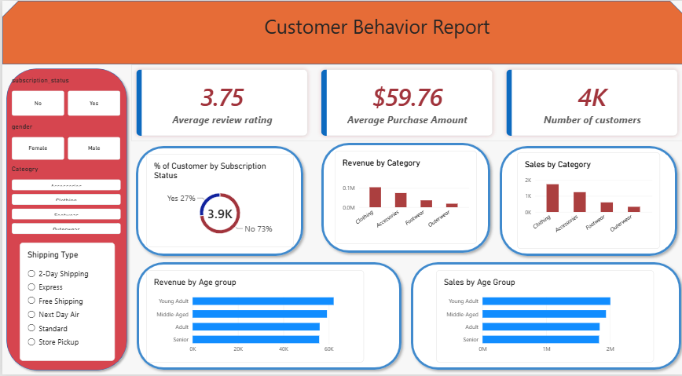

# Customer_Behavior_Analysis
# Customer Shopping Behavior Analysis

An end-to-end data analytics project exploring customer purchasing patterns, product preferences, discount behavior, customer segmentation, and subscription trends using **Python, PostgreSQL, and Power BI**.

## Project Overview

This project analyzes **3,900 shopping transactions across 18 columns** to identify customer behavior patterns and generate actionable business insights.

The objective is to understand what drives purchasing behavior, identify valuable customer segments, evaluate discount effectiveness, and provide data-driven recommendations to improve customer retention and revenue.

## Tech Stack

| Technology | Purpose |
|---|---|
| Python | Data cleaning, preprocessing, EDA and feature engineering |
| Pandas | Data manipulation and analysis |
| PostgreSQL | Database management and SQL-based analysis |
| Power BI | Interactive dashboard and data visualization |
| PowerPoint | Executive summary and business presentation |

## Project Workflow

1. Data loading and initial exploration using Python.
2. Data cleaning, preprocessing and feature engineering.
3. Integration of the cleaned dataset into PostgreSQL.
4. SQL-based analysis to answer business questions.
5. Dashboard development and visualization using Power BI.
6. Business insights and recommendations presented through PowerPoint.

## 1. Data Cleaning & Exploratory Data Analysis (Python)

Used Python and Pandas to prepare the raw dataset for analysis.

**Key operations:**
- Loaded and inspected the dataset using `pandas`.
- Explored dataset structure using `df.info()` and `df.describe()`.
- Identified 37 missing values in the `review_rating` column.
- Imputed missing ratings using the median rating of each product category.
- Standardized column names using snake_case.
- Created an `age_group` feature by categorizing customer ages.
- Engineered a `purchase_frequency_days` feature.
- Identified redundancy between `discount_applied` and `promo_code_used` and removed the latter.
- Connected Python to PostgreSQL and loaded the cleaned dataset.

## 2. Business Analysis (PostgreSQL)

Used SQL queries to investigate customer behavior and answer 10 business questions.

**Analysis performed:**

1. **Revenue by Gender:** Compared total revenue generated by male and female customers.
2. **High-Spending Discount Users:** Identified customers who used discounts but still spent above the average purchase amount.
3. **Top Products by Rating:** Identified the five highest-rated products.
4. **Shipping Type Comparison:** Compared average purchase amounts between Standard and Express shipping.
5. **Subscription Analysis:** Compared average spending and total revenue between subscribers and non-subscribers.
6. **Discount-Dependent Products:** Identified products with the highest percentage of discounted purchases.
7. **Customer Segmentation:** Classified customers into New, Returning, and Loyal segments.
8. **Top Products per Category:** Identified the three most-purchased products within each category.
9. **Repeat Buyers & Subscriptions:** Examined subscription behavior among customers with more than five purchases.
10. **Revenue by Age Group:** Analyzed revenue contributions across different age groups.

## 3. Power BI Dashboard
 
Developed an interactive Power BI dashboard to visualize key business metrics and customer purchasing patterns.

**Dashboard features:**
- Total customer records
- Average purchase amount
- Average product rating
- Subscription distribution
- Revenue by product category
- Sales by product category
- Revenue by age group
- Sales by age group
- Interactive filters for subscription status, gender, category, and shipping type

**Key dashboard metrics:**

| Metric | Result |
|---|---:|
| Transactions | 3,900 |
| Average Purchase Amount | $59.76 |
| Average Review Rating | 3.75 |
| Subscribers | 27% |
| Non-subscribers | 73% |

## 4. Key Business Insights

The analysis revealed several important patterns:

**Revenue Distribution**
- Male customers generated $157,890 in revenue.
- Female customers generated $75,191 in revenue.

**Product Performance**
- Gloves had the highest average rating at 3.86.
- Sandals followed at 3.84.
- Boots ranked third at 3.82.

**Discount Behavior**
- Hats had the highest discount rate at 50%.
- Sneakers followed at 49.66%.
- Coats followed at 49.07%.

**Customer Segmentation**
- Loyal: 3,116 records.
- Returning: 701 records.
- New: 83 records.

**Age Group Revenue**
- Young Adults: $62,143.
- Middle-aged: $59,197.
- Adults: $55,978.
- Seniors: $55,763.

**Subscription Behavior**
- 27% of records belonged to subscribers.
- 73% belonged to non-subscribers.

## 5. Business Recommendations

Based on the findings, the following strategies were proposed:

- **Boost Subscriptions:** Introduce exclusive subscriber benefits to improve subscription conversion.
- **Customer Retention:** Implement loyalty programs to encourage repeat purchases.
- **Optimize Discount Strategies:** Review discount policies for products with high discount dependence while protecting profit margins.
- **Product Positioning:** Promote highly rated and frequently purchased products.
- **Targeted Marketing:** Focus marketing campaigns on high-revenue age groups and relevant customer segments.

## Project Deliverables

- Python notebook/script for data cleaning and exploratory analysis.
- PostgreSQL SQL queries for business analysis.
- Power BI interactive dashboard.
- PDF project report.
- PowerPoint executive summary.

## Conclusion

This project demonstrates an end-to-end data analytics workflow, from raw data preparation and database integration to SQL-based business analysis, interactive visualization, and communicating findings through an executive presentation.

The insights provide a foundation for improving customer retention, optimizing promotional strategies, and making informed marketing and merchandising decisions.
